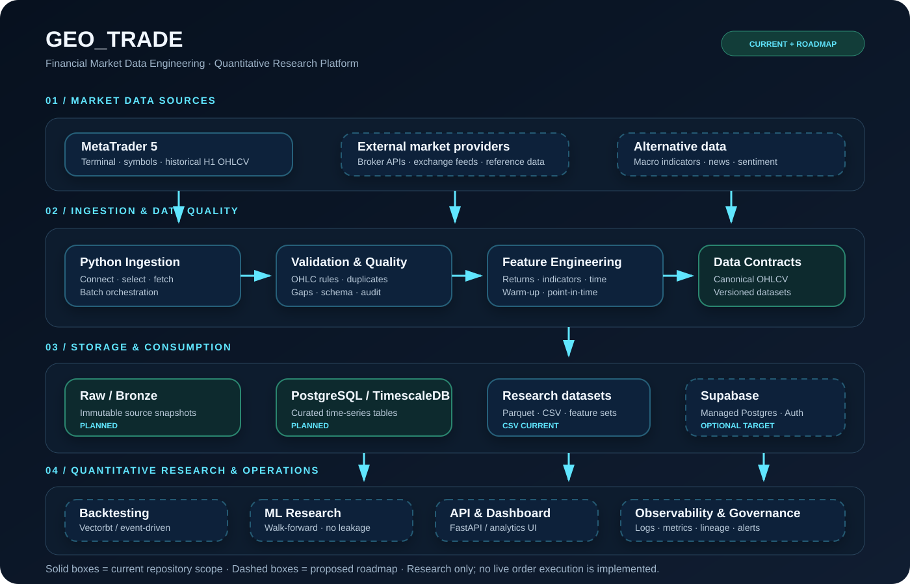

# GEO_TRADE

<p align="center">
  <strong>Financial Data Engineering · Quantitative Research</strong><br/>
  A modular foundation for reliable market-data ingestion, reproducible research, and systematic strategy validation.
</p>

<p align="center">
  
</p>

<p align="center">
  
  
  
  
  
</p>

## Overview

GEO_TRADE is an evolving engineering project focused on market-data ingestion, data quality, feature engineering, and quantitative research. The repository currently contains two independent ingestion workflows from MetaTrader 5:

- **H1 feature workflow:** collects hourly candles, validates OHLC records, calculates descriptive technical features, and exports datasets as CSV.
- **M1 historical workflow:** collects one-minute candles for a Brasília calendar day, converts the requested interval to UTC, and persists candles and instrument metadata in SQLite.

The workflows address different research needs and have independent entry points and output formats.

> Scope transparency: MT5 ingestion, H1 feature calculation, CSV export, and M1 persistence in SQLite are implemented. API services, dashboards, strategy backtesting, machine learning, and broker order execution remain on the development roadmap.

## Platform architecture

| Layer | Responsibility | Status |
|---|---|---|
| Market data | MetaTrader 5 terminal | Implemented |
| Ingestion and quality | H1/M1 extraction, OHLC validation, deduplication, and H1 feature engineering | Initial implementation |
| Storage and consumption | CSV exports and SQLite persistence | Implemented |
| Quantitative research and operations | Backtesting, model validation, API, dashboard, and observability | Planned |

See the [architecture notes](docs/architecture.md) and the [SVG diagram](docs/assets/geo-trade-architecture.svg).

## Repository structure

```text
GEO_TRADE/
├── data/
│   └── exports/                       # Generated files (ignored by Git)
├── docs/
│   ├── architecture.md
│   └── assets/
│       └── geo-trade-architecture.svg
├── src/
│   └── ingestion/
│       ├── market_ingestion.py        # H1 -> features -> CSV
│       └── trade2_geo_trade_v2.py     # M1 -> SQLite
├── tests/
│   └── test_features.py
├── .env.example
├── .gitignore
├── requirements.txt
└── README.md
```

## H1 workflow: features and CSV

The H1 entry point is `src.ingestion.market_ingestion`.

1. Initializes the local MetaTrader 5 terminal and checks account availability.
2. Resolves the requested symbols or lists the symbols available in the terminal.
3. Retrieves H1 candles with an additional historical warm-up window for calculations.
4. Validates required columns, finite and representable timestamps, non-Boolean market values, and OHLC consistency; removes identical duplicate candles and rejects conflicting candles at the same timestamp.
5. Sorts candles chronologically before calculating candle anatomy, returns, moving averages, RSI, ATR, MACD, Bollinger Bands, and time-based features.
6. Filters records for the requested UTC day.
7. Removes duplicates by symbol, timeframe, and timestamp, then exports a consolidated CSV.

Examples:

```powershell
python -m src.ingestion.market_ingestion
python -m src.ingestion.market_ingestion --date 2026-08-21
python -m src.ingestion.market_ingestion --date 2026-08-21 --symbols EURUSD GBPUSD USDJPY
```

Indicators are descriptive features, not trading signals or evidence of predictive performance. The latest H1 candle may still be forming.

## M1 workflow: historical candles and SQLite

The M1 entry point is `src/ingestion/trade2_geo_trade_v2.py`. It stores raw one-minute candle fields in OHLCV format and instrument metadata; it does not calculate technical indicators.

Key behaviors:

- Interprets `--date` as a Brasília calendar date (UTC−03:00); by default, it processes the previous Brasília day.
- Converts local-day boundaries to UTC and applies a half-open interval: `[start, end)`.
- Stores timestamps in UTC and Brasília time for each candle.
- Validates each M1 candle before persistence: finite and positive prices, consistent OHLC bounds, and non-negative integer volume/spread fields; Boolean values and invalid records are rejected before writing to SQLite.
- Uses a unique key on `(symbol, timeframe, timestamp_utc)` and `INSERT OR IGNORE` to make repeated imports idempotent.
- Updates instrument metadata without replacing the main record.
- Reports processed instruments, candles found and inserted, errors, and database totals; rejected market records can be inspected in each symbol's output.
- Can optionally open DB Browser for SQLite after execution.

Examples (PowerShell):

```powershell
python .\src\ingestion\trade2_geo_trade_v2.py
python .\src\ingestion\trade2_geo_trade_v2.py --date 2026-08-21
python .\src\ingestion\trade2_geo_trade_v2.py --symbols EURUSD GBPUSD
python .\src\ingestion\trade2_geo_trade_v2.py --no-open-db
```

Optional arguments:

- `--date YYYY-MM-DD`: Brasília calendar date to extract.
- `--symbols`: one or more MT5 instrument symbols; without this argument, the script lists the terminal's symbols.
- `--terminal-path`: path to `terminal64.exe`.
- `--db-path`: SQLite database destination (default: `~/Downloads/geo_trade_completo.db`).
- `--no-open-db`: skips the optional DB Browser launch.

The M1 script requires the Python packages `MetaTrader5` and `colorama`. The terminal must be installed, running or available for launch at the configured path, and authenticated with access to the requested market history.

## Requirements

- Windows with the MetaTrader 5 desktop terminal installed.
- A valid account authenticated in the terminal.
- Python 3.10 or newer.
- Dependencies listed in `requirements.txt`.

## Setup (PowerShell)

```powershell
py -m venv .venv
.\.venv\Scripts\Activate.ps1
python -m pip install --upgrade pip
pip install -r requirements.txt
```

If script activation is restricted, invoke the virtual environment's interpreter directly.

## Tests

```powershell
python -m pytest
```

Automated tests cover chronological feature calculation, H1 schema/timestamp/duplicate quality controls, M1 OHLCV type and value validation, SQLite idempotency, and date boundaries between Brasília and UTC. Real-environment M1 extraction still depends on a locally authenticated MT5 terminal and must be tested in that environment.

## Engineering principles

- Explicit UTC timestamps and documented time-zone conversion.
- Additional historical warm-up data before calculating rolling indicators.
- Temporal discipline and chronological validation for future machine-learning work.
- Data-quality checks, deterministic identifiers, and reproducible exports.
- Idempotent persistence for repeated M1 imports.
- Credentials and generated market data excluded from version control.
- No profitability claims without out-of-sample evidence and realistic costs.

## Development roadmap

- [x] Initial MT5 H1 ingestion and CSV export.
- [x] OHLC validation and initial technical feature implementation.
- [x] M1 historical ingestion and SQLite persistence.
- [x] Repository documentation and architecture diagram.
- [ ] Automated integration test with an active MT5 terminal.
- [ ] Structured logging, execution metadata, and ingestion checkpoints.
- [ ] Database migrations and retention strategy.
- [ ] API and analytics dashboard.
- [ ] Backtesting with fees, spread, slippage, and walk-forward evaluation.
- [ ] Machine-learning experiments with leakage controls, model tracking, and drift monitoring.

## Security

Never commit broker credentials, passwords, API keys, `.env` files, terminal data directories, account identifiers, or private raw datasets. Use public sample data in demonstrations.

## Disclaimer

GEO_TRADE is a software engineering and quantitative research project. It does not provide investment advice and currently does not implement real-time order execution.
