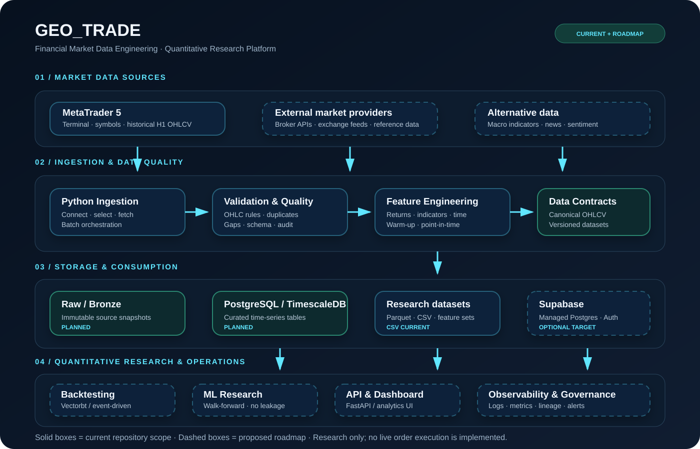

# GEO_TRADE

<p align="center">
  <strong>Financial Market Data Engineering · Quantitative Research</strong><br/>
  A modular foundation for reliable market data, reproducible research and systematic strategy validation.
</p>

<p align="center">
  
</p>

<p align="center">
  
  
  
  
  
</p>

## Overview

GEO_TRADE is an evolving engineering project focused on market-data ingestion, data quality, feature engineering and quantitative research. The current implementation collects H1 bars from an authenticated MetaTrader 5 desktop terminal, validates OHLC records, calculates descriptive features and exports reproducible CSV datasets.

> Scope transparency: MT5 ingestion and CSV export are implemented. Database persistence, API services, dashboards, backtesting, machine learning and broker execution are roadmap items—not current capabilities.

## Platform architecture

The platform is organized into four logical layers:

| Layer | Responsibility | Status |
|---|---|---|
| Market data | MT5 terminal and future external providers | MT5 implemented |
| Ingestion & quality | Extraction, validation, deduplication, feature engineering | Implemented baseline |
| Storage & consumption | CSV now; PostgreSQL/TimescaleDB or Supabase later | CSV implemented |
| Quant research & operations | Backtesting, ML validation, API, dashboard, observability | Roadmap |

See [the architecture notes](docs/architecture.md) and [the SVG diagram](docs/assets/geo-trade-architecture.svg).

## Repository structure

```text
GEO_TRADE/
├── data/
│   └── exports/                 # Generated files (ignored by Git)
├── docs/
│   ├── architecture.md
│   └── assets/
│       └── geo-trade-architecture.svg
├── src/
│   └── ingestion/
│       └── market_ingestion.py
├── tests/
│   └── test_features.py
├── .env.example
├── .gitignore
├── requirements.txt
└── README.md
```

## Current ingestion pipeline

1. Initialize the local MetaTrader 5 terminal and verify account availability.
2. Resolve requested symbols or enumerate symbols available in the terminal.
3. Retrieve H1 bars with a preceding warm-up window.
4. Validate OHLC consistency and reject invalid rows.
5. Calculate candle anatomy, returns, moving averages, RSI, ATR, MACD, Bollinger bands and time features.
6. Filter to the requested UTC calendar day.
7. Deduplicate by symbol, timeframe and timestamp, then export a consolidated CSV.

The indicators are descriptive features, not trading signals or evidence of predictive performance. The last H1 bar may still be forming.

## Requirements

- Windows with MetaTrader 5 desktop terminal installed.
- A valid account authenticated in the terminal.
- Python 3.10+ and access to the requested symbol history.

## Setup (PowerShell)

```powershell
py -m venv .venv
.\.venv\Scripts\Activate.ps1
python -m pip install --upgrade pip
pip install -r requirements.txt
```

If script activation is restricted, invoke the environment interpreter directly.

## Run

```powershell
# Collect the current UTC date
python -m src.ingestion.market_ingestion

# Collect a specific UTC date
python -m src.ingestion.market_ingestion --date 2026-08-21

# Limit collection to selected instruments
python -m src.ingestion.market_ingestion --date 2026-08-21 --symbols EURUSD GBPUSD USDJPY
```

Optional arguments:

- `--terminal-path`: path to `terminal64.exe`.
- `--output-dir`: destination for generated CSV files.
- `--symbols`: one or more MT5 instrument symbols.

## Tests

```powershell
python -m pytest
```

Tests cover feature columns, OHLC validation and UTC date boundaries. The MT5 integration still requires a locally authenticated terminal and must be validated in that environment.

## Engineering principles

- Explicit UTC timestamps and documented timezone conversion.
- Warm-up history before rolling indicator calculation.
- Point-in-time discipline and temporal validation for future ML work.
- Data quality checks, deterministic identifiers and reproducible exports.
- Secrets and generated market data excluded from version control.
- No claim of profitability without out-of-sample evidence and realistic costs.

## Roadmap

- [x] Initial MT5 H1 ingestion and CSV export.
- [x] OHLC validation and technical feature baseline.
- [x] Repository documentation and architecture diagram.
- [ ] Integration test against a live MT5 terminal.
- [ ] Structured logging, run metadata and ingestion checkpoints.
- [ ] PostgreSQL/TimescaleDB persistence and migrations.
- [ ] API and analytical dashboard.
- [ ] Backtesting with fees, spread, slippage and walk-forward evaluation.
- [ ] ML experiments with leakage controls, model registry and drift monitoring.

## Security

Never commit broker credentials, passwords, API keys, `.env` files, terminal data directories, account identifiers or raw private datasets. Use public sample data for demonstrations.

## Disclaimer

GEO_TRADE is a software engineering and quantitative research project. It does not provide investment advice and does not currently implement live order execution.
