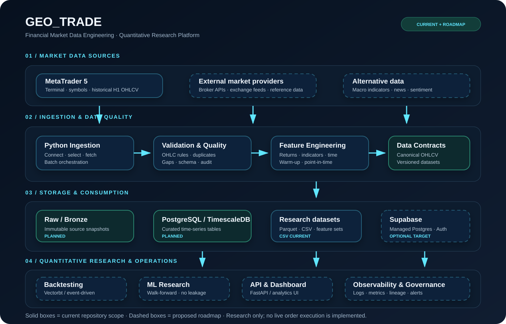

# GEO_TRADE

<p align="center">
  <strong>Financial Market Data Engineering · Quantitative Research</strong><br/>
  A modular foundation for reliable market data, reproducible research and systematic strategy validation.
</p>

<p align="center">
  
</p>

<p align="center">
  
  
  
  
  
</p>

## Overview

GEO_TRADE is an evolving engineering project focused on market-data ingestion, data quality, feature engineering and quantitative research. The repository currently contains two independent MetaTrader 5 ingestion paths:

- **H1 feature pipeline:** collects hourly bars, validates OHLC records, calculates descriptive technical features and exports CSV datasets.
- **M1 historical pipeline:** collects one-minute bars for a Brasília calendar day, converts the requested interval to UTC and persists candles and instrument metadata in SQLite.

These pipelines serve different research needs and have separate entry points and output formats.

> Scope transparency: MT5 ingestion, H1 feature calculation, CSV export and M1 SQLite persistence are implemented. API services, dashboards, backtesting, machine learning and broker execution remain roadmap items.

## Platform architecture

| Layer | Responsibility | Status |
|---|---|---|
| Market data | MetaTrader 5 terminal | Implemented |
| Ingestion & quality | H1/M1 extraction, OHLC validation, deduplication and H1 feature engineering | Implemented baseline |
| Storage & consumption | CSV exports and SQLite persistence | Implemented |
| Quant research & operations | Backtesting, ML validation, API, dashboard and observability | Roadmap |

See [the architecture notes](docs/architecture.md) and [the SVG diagram](docs/assets/geo-trade-architecture.svg).

## Repository structure

```text
GEO_TRADE/
├── data/
│   └── exports/                       # Generated files (ignored by Git)
├── docs/
│   ├── architecture.md
│   └── assets/
│       └── geo-trade-architecture.svg
├── src/
│   └── ingestion/
│       ├── market_ingestion.py        # H1 -> features -> CSV
│       └── trade2_geo_trade_v2.py     # M1 -> SQLite
├── tests/
│   └── test_features.py
├── .env.example
├── .gitignore
├── requirements.txt
└── README.md
```

## H1 pipeline: features and CSV

The H1 entry point is `src.ingestion.market_ingestion`.

1. Initialize the local MetaTrader 5 terminal and verify account availability.
2. Resolve requested symbols or enumerate symbols available in the terminal.
3. Retrieve H1 bars with a preceding warm-up window.
4. Validate OHLC consistency and reject invalid rows.
5. Calculate candle anatomy, returns, moving averages, RSI, ATR, MACD, Bollinger bands and time features.
6. Filter to the requested UTC calendar day.
7. Deduplicate by symbol, timeframe and timestamp, then export a consolidated CSV.

Example:

```powershell
python -m src.ingestion.market_ingestion
python -m src.ingestion.market_ingestion --date 2026-08-21
python -m src.ingestion.market_ingestion --date 2026-08-21 --symbols EURUSD GBPUSD USDJPY
```

The indicators are descriptive features, not trading signals or evidence of predictive performance. The last H1 bar may still be forming.

## M1 pipeline: historical candles and SQLite

The M1 entry point is `src/ingestion/trade2_geo_trade_v2.py`. It stores raw one-minute OHLCV-style candle fields and instrument metadata; it does not calculate technical indicators.

Key behaviors:

- Interprets `--date` as a calendar date in Brasília (UTC−03:00); by default, processes the previous Brasília day.
- Converts the local day boundaries to UTC and applies a half-open interval: `[start, end)`.
- Stores UTC and Brasília timestamps for each candle.
- Validates each M1 candle before persistence: finite positive prices, coherent OHLC bounds and non-negative volume/spread fields; invalid records are skipped.
- Uses a unique key on `(symbol, timeframe, timestamp_utc)` and `INSERT OR IGNORE` to make repeated imports idempotent.
- Upserts instrument metadata without replacing the parent row.
- Reports processed instruments, candles found/inserted, errors and database totals; rejected market records can be inspected in the per-symbol output.
- Can optionally open DB Browser for SQLite after the run.

Example (PowerShell):

```powershell
python .\src\ingestion\trade2_geo_trade_v2.py
python .\src\ingestion\trade2_geo_trade_v2.py --date 2026-08-21
python .\src\ingestion\trade2_geo_trade_v2.py --symbols EURUSD GBPUSD
python .\src\ingestion\trade2_geo_trade_v2.py --no-open-db
```

Optional arguments:

- `--date YYYY-MM-DD`: Brasília calendar date to extract.
- `--symbols`: one or more MT5 instrument symbols; without it, the script enumerates terminal symbols.
- `--terminal-path`: path to `terminal64.exe`.
- `--db-path`: SQLite database destination (default: `~/Downloads/geo_trade_completo.db`).
- `--no-open-db`: skip the optional DB Browser launch.

The M1 script requires the `MetaTrader5` and `colorama` Python packages. The terminal must be installed, running or launchable at the configured path, and authenticated with access to the requested market history.

## Requirements

- Windows with MetaTrader 5 desktop terminal installed.
- A valid account authenticated in the terminal.
- Python 3.10+.
- Dependencies listed in `requirements.txt`.

## Setup (PowerShell)

```powershell
py -m venv .venv
.\.venv\Scripts\Activate.ps1
python -m pip install --upgrade pip
pip install -r requirements.txt
```

If script activation is restricted, invoke the environment interpreter directly.

## Tests

```powershell
python -m pytest
```

The automated tests cover H1 feature columns and OHLC validation, M1 OHLCV quality gates, SQLite idempotency and Brasília-to-UTC date boundaries. The live M1 extraction still depends on a locally authenticated MT5 terminal and should be integration-tested in that environment.

## Engineering principles

- Explicit UTC timestamps and documented timezone conversion.
- Warm-up history before rolling indicator calculation.
- Point-in-time discipline and temporal validation for future ML work.
- Data quality checks, deterministic identifiers and reproducible exports.
- Idempotent persistence for repeated M1 imports.
- Secrets and generated market data excluded from version control.
- No claim of profitability without out-of-sample evidence and realistic costs.

## Roadmap

- [x] Initial MT5 H1 ingestion and CSV export.
- [x] OHLC validation and technical feature baseline.
- [x] M1 historical ingestion and SQLite persistence.
- [x] Repository documentation and architecture diagram.
- [ ] Automated integration test against a live MT5 terminal.
- [ ] Structured logging, run metadata and ingestion checkpoints.
- [ ] Database migrations and retention strategy.
- [ ] API and analytical dashboard.
- [ ] Backtesting with fees, spread, slippage and walk-forward evaluation.
- [ ] ML experiments with leakage controls, model registry and drift monitoring.

## Security

Never commit broker credentials, passwords, API keys, `.env` files, terminal data directories, account identifiers or raw private datasets. Use public sample data for demonstrations.

## Disclaimer

GEO_TRADE is a software engineering and quantitative research project. It does not provide investment advice and does not currently implement live order execution.
